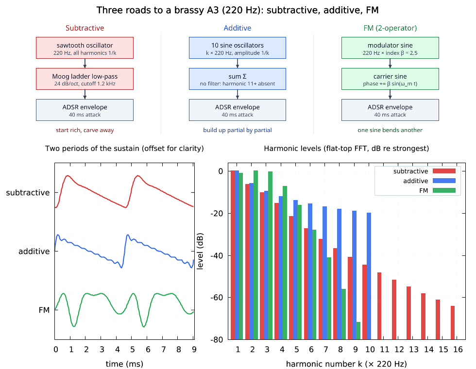
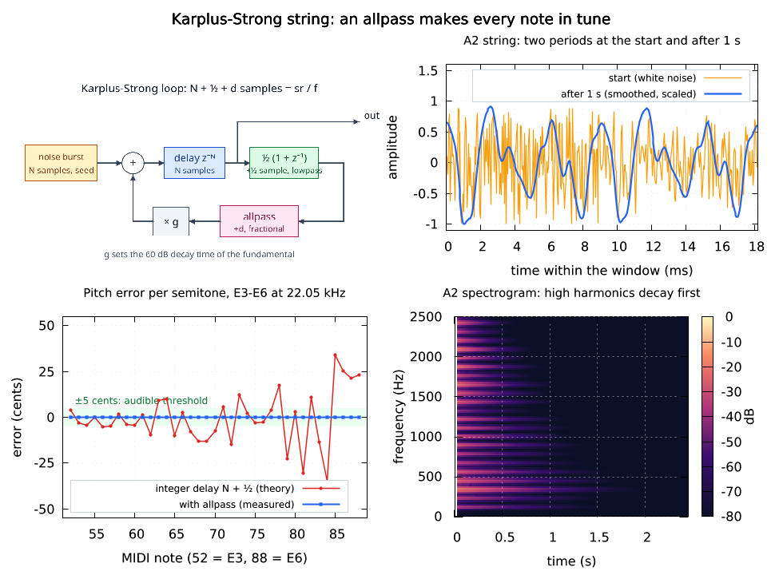
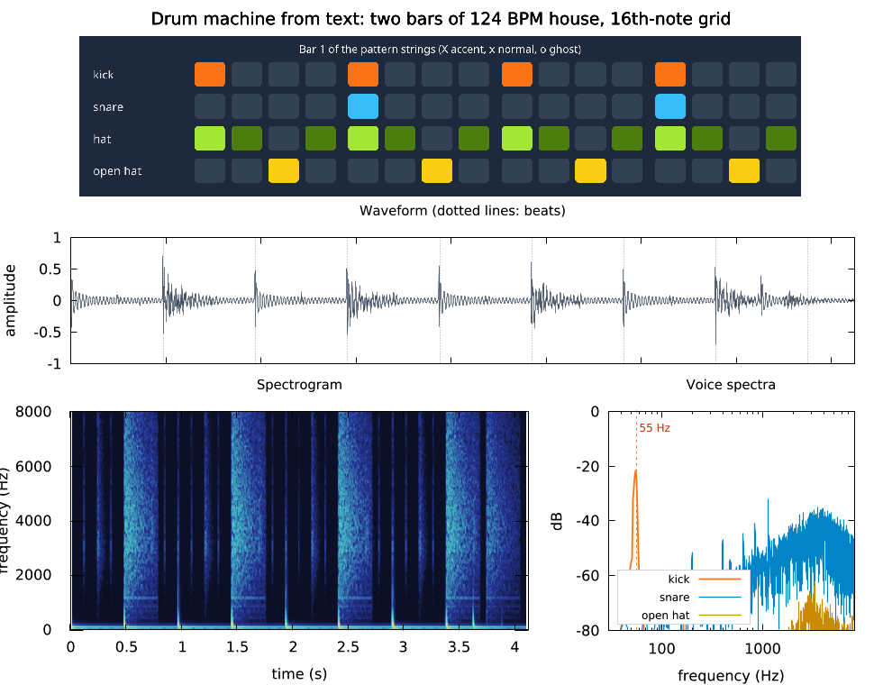
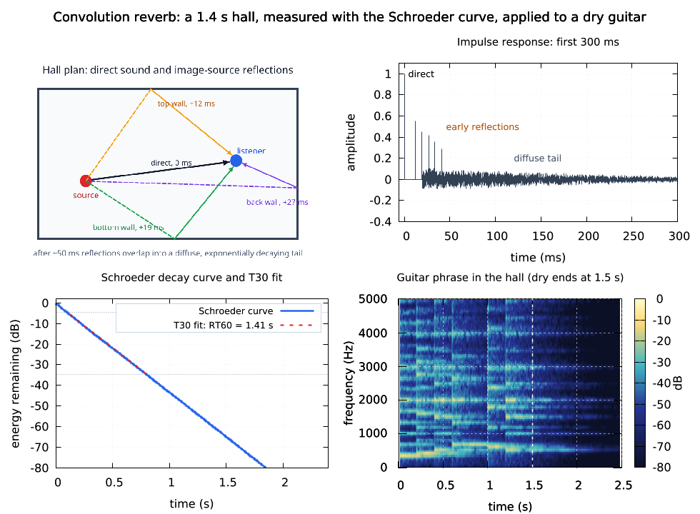
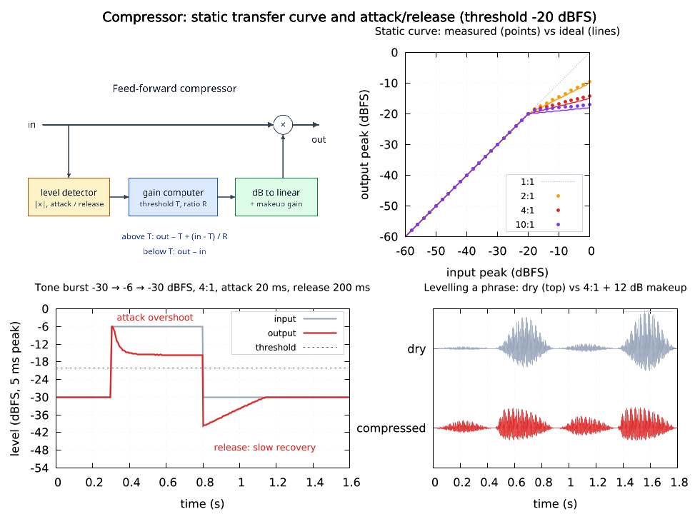
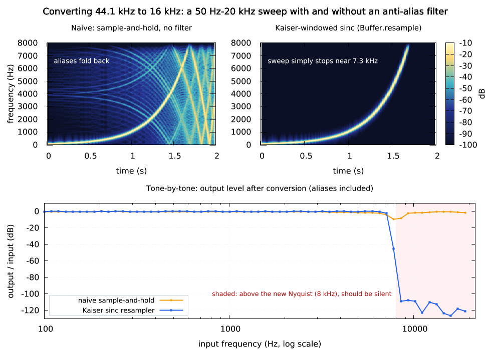
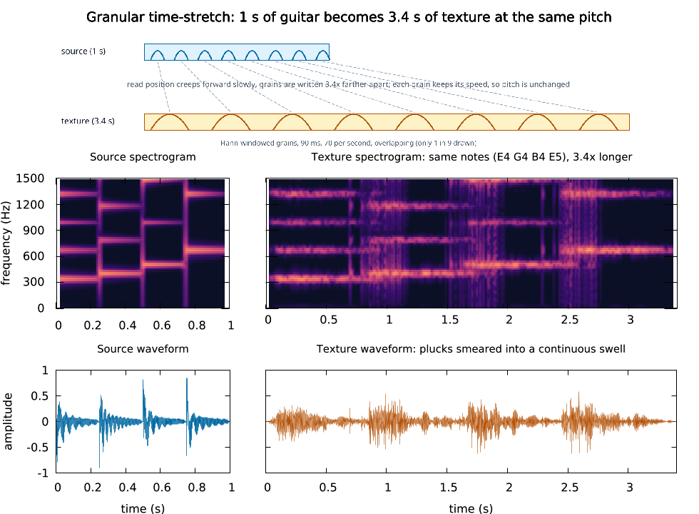
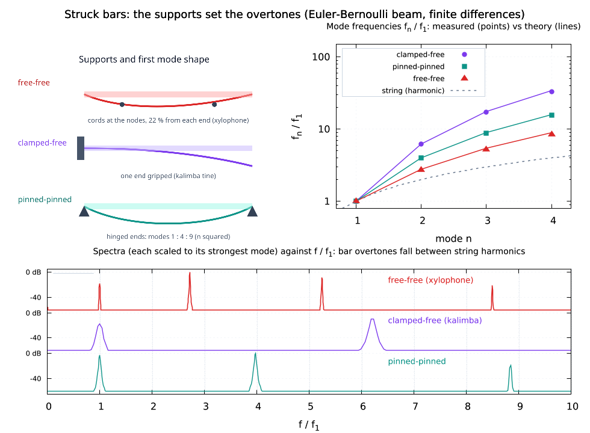
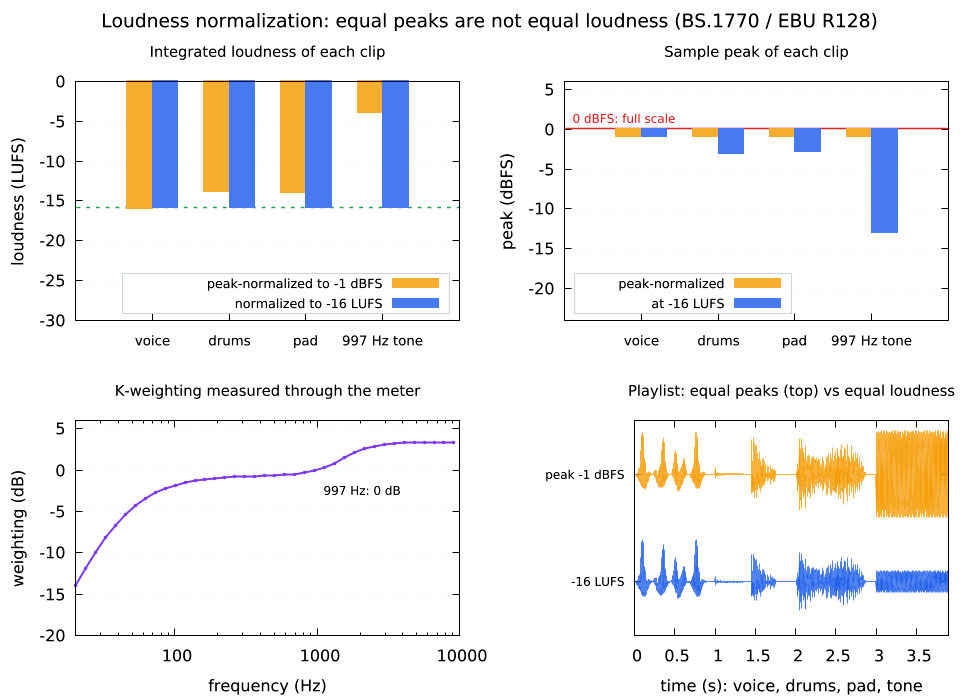

# lmaudio

> The public README, docs, images, and examples for `lmaudio` are MIT under `LICENSE-examples`. Binary releases use `LICENSE`; implementation source and its history are maintained privately in `lmctlhq/lmaudio`.

**Audio synthesis, physical models, filters, effects and analysis as one static executable, scripted from lmscript: DaisySP and Soundpipe (MIT) plus original MIT DSP, FFT, loudness and WAV code. Offline rendering, deterministic output, no sound card needed.**

[](https://github.com/lmctl-ai/lmaudio/actions/workflows/public-ci.yml)
[](https://github.com/lmctl-ai/lmaudio/releases)
[](LICENSE-examples)

| Three roads to one note: subtractive, additive, FM | Karplus-Strong string: an allpass fixes the tuning | A drum machine from text |
| --- | --- | --- |
| <a href="#synthesis_methods_compared"></a> | <a href="#karplus_strong_tuning"></a> | <a href="#drum_machine_pattern"></a> |

| Convolution reverb with a measured RT60 | Compressor: transfer curve and attack/release | Sample-rate conversion without aliasing |
| --- | --- | --- |
| <a href="#convolution_reverb_rt60"></a> | <a href="#compressor_transfer_curve"></a> | <a href="#sample_rate_conversion_quality"></a> |

Every picture and sound below is made by an example in `examples/` that synthesizes its own input, checks its result against a known answer, writes a WAV (16-bit mono, 22.05 kHz, under 200 KB) and draws the figure with [lmplot](https://github.com/lmctl-ai/lmplot) (and [lmdraw](https://github.com/lmctl-ai/lmdraw) for the diagrams). Run any of them from an empty directory with the command under it; it writes `images/<name>.png` and `audio/<name>.wav`. GitHub does not play WAV files inline: open the audio link and use *Download raw file*.

## Gallery

### Synthesis

<a id="synthesis_methods_compared"></a>
#### Three roads to one note: subtractive, additive, FM


The same brassy A3 made three ways, with lmdraw signal-flow diagrams, the waveforms and a harmonic bar chart: additive stops dead at harmonic 10, the Moog ladder rolls off smoothly, FM follows Bessel functions. All three are asserted to sound at 220 Hz. Audio: [`synthesis_methods_compared.wav`](docs/audio/synthesis_methods_compared.wav) (168 KB).

```sh
lmctl autorun https://raw.githubusercontent.com/lmctl-ai/lmaudio/main/examples/synthesis_methods_compared.lms
```

<a id="polyblep_harmonics"></a>
#### Band-limited PolyBLEP oscillators


Sine, triangle, square and sawtooth at 440 Hz and their spectra: odd harmonics at 1/n² and 1/n for triangle and square, all harmonics at 1/n for the saw, with no aliasing junk between them. Audio: [`polyblep_harmonics.wav`](docs/audio/polyblep_harmonics.wav) (112 KB).

```sh
lmctl autorun https://raw.githubusercontent.com/lmctl-ai/lmaudio/main/examples/polyblep_harmonics.lms
```

<a id="fm_bell_spectrum"></a>
#### FM sidebands follow Bessel functions


Chowning two-operator FM at β = 0.5, 1.5 and 3: the flat-top FFT peaks land on the circles 0.85 |J_k(β)|, asserted to 0.01 for β = 1.5. Higher index spreads energy into more sidebands. Audio: [`fm_bell_spectrum.wav`](docs/audio/fm_bell_spectrum.wav) (116 KB).

```sh
lmctl autorun https://raw.githubusercontent.com/lmctl-ai/lmaudio/main/examples/fm_bell_spectrum.lms
```

<a id="synth_lead_melody"></a>
#### Melody, bassline and chords from note strings


`audio.sequence("A4:0.75 C5:0.25 E5:0.5 ...", 128, "saw")` renders a lead, an octave bass and chords; the voices and the mix are shown separately above the spectrogram. Audio: [`synth_lead_melody.wav`](docs/audio/synth_lead_melody.wav) (162 KB).

```sh
lmctl autorun https://raw.githubusercontent.com/lmctl-ai/lmaudio/main/examples/synth_lead_melody.lms
```

<a id="granular_texture"></a>
#### Granular time-stretch



A 1-second guitar arpeggio becomes a 3.4-second texture at the same pitch: the read position creeps forward while grains are written further apart (diagram). The first note still reads E4 (asserted). Audio: [`granular_texture.wav`](docs/audio/granular_texture.wav) (187 KB).

```sh
lmctl autorun https://raw.githubusercontent.com/lmctl-ai/lmaudio/main/examples/granular_texture.lms
```

<a id="harmonic_morph_anim"></a>
#### Animated wavefolding and ladder-filter morph


Frame-by-frame GIF of a sine being folded and filtered: the waveform and its spectrum grow and lose upper harmonics as the fold gain and cutoff sweep. Audio: [`harmonic_morph_anim.wav`](docs/audio/harmonic_morph_anim.wav) (125 KB).

```sh
lmctl autorun https://raw.githubusercontent.com/lmctl-ai/lmaudio/main/examples/harmonic_morph_anim.lms
```

### Physical models

<a id="karplus_strong_tuning"></a>
#### Karplus-Strong string: an allpass fixes the tuning


With an integer delay line the plucked string plays up to 35 cents out of tune in the top octave; `audio.karplus` adds a fractional-delay allpass and every semitone E3-E6 lands within 0.03 cent (asserted). Also: the noise burst turning into a tone, and high harmonics dying first. Audio: [`karplus_strong_tuning.wav`](docs/audio/karplus_strong_tuning.wav) (172 KB).

```sh
lmctl autorun https://raw.githubusercontent.com/lmctl-ai/lmaudio/main/examples/karplus_strong_tuning.lms
```

<a id="xylophone_bar_modes"></a>
#### Struck bars: the supports set the overtones



Free-free (xylophone), clamped-free (kalimba) and pinned bars solved as Euler-Bernoulli beams: the measured mode ratios 1 : 2.76 : 5.40, 1 : 6.27 : 17.5 and 1 : 4 : 9 match the textbook within 3 % (asserted), and bars are tuned by strike-measure-correct to play a phrase. Audio: [`xylophone_bar_modes.wav`](docs/audio/xylophone_bar_modes.wav) (181 KB).

```sh
lmctl autorun https://raw.githubusercontent.com/lmctl-ai/lmaudio/main/examples/xylophone_bar_modes.lms
```

<a id="karplus_strong_harp"></a>
#### Plucked-string harp


DaisySP's StringVoice (bright vs damped pluck) playing an arpeggio and a chord through the FDN reverb, with its spectrogram. Audio: [`karplus_strong_harp.wav`](docs/audio/karplus_strong_harp.wav) (129 KB).

```sh
lmctl autorun https://raw.githubusercontent.com/lmctl-ai/lmaudio/main/examples/karplus_strong_harp.lms
```

### Rhythm

<a id="drum_machine_pattern"></a>
#### A drum machine from text


`kick.pattern("X...X...X...X...", 124, 4)`: four 808-style voices on a 16th-note grid (drawn as a step-sequencer panel). The kick is asserted to sound at 55 Hz and hits to land exactly on the grid. Audio: [`drum_machine_pattern.wav`](docs/audio/drum_machine_pattern.wav) (178 KB).

```sh
lmctl autorun https://raw.githubusercontent.com/lmctl-ai/lmaudio/main/examples/drum_machine_pattern.lms
```

<a id="analog_drum_kit"></a>
#### 808 drum voices


Kick, snare and hi-hat transients and spectra (the kick's 55 Hz peak), then a two-bar groove. Audio: [`analog_drum_kit.wav`](docs/audio/analog_drum_kit.wav) (134 KB).

```sh
lmctl autorun https://raw.githubusercontent.com/lmctl-ai/lmaudio/main/examples/analog_drum_kit.lms
```

### Filters, dynamics and effects

<a id="biquad_filter_bank"></a>
#### RBJ biquad filter bank


Exact magnitude and phase of low-pass, high-pass, band-pass, notch, peak and shelf biquads from the Audio-EQ-Cookbook formulas (-3 dB at cutoff and zero at the notch are asserted in the tests). Audio: [`biquad_filter_bank.wav`](docs/audio/biquad_filter_bank.wav) (121 KB).

```sh
lmctl autorun https://raw.githubusercontent.com/lmctl-ai/lmaudio/main/examples/biquad_filter_bank.lms
```

<a id="eq_before_after"></a>
#### Four-band mastering EQ, before and after


A mix with hum, mud and a harsh 2.4 kHz ring is cleaned by a high-pass, two peak cuts and an air shelf: spectrograms, band curves and spectra before/after; the ring drops by more than 11 dB (asserted). Audio: [`eq_before_after.wav`](docs/audio/eq_before_after.wav) (137 KB).

```sh
lmctl autorun https://raw.githubusercontent.com/lmctl-ai/lmaudio/main/examples/eq_before_after.lms
```

<a id="moog_ladder_sweep"></a>
#### Moog ladder filter sweep


A sawtooth through a resonant 24 dB/oct ladder whose cutoff sweeps 140 Hz to 4.2 kHz: the resonant peak walks up the harmonic comb. Audio: [`moog_ladder_sweep.wav`](docs/audio/moog_ladder_sweep.wav) (121 KB).

```sh
lmctl autorun https://raw.githubusercontent.com/lmctl-ai/lmaudio/main/examples/moog_ladder_sweep.lms
```

<a id="compressor_transfer_curve"></a>
#### Compressor: transfer curve and attack/release


Measured static curves for 2:1, 4:1 and 10:1 against the ideal knee (unity below threshold and slope 1/ratio above, asserted), the attack overshoot and slow release on a tone burst, and a phrase whose syllable levels shrink from a 26 dB to a 9 dB spread. Audio: [`compressor_transfer_curve.wav`](docs/audio/compressor_transfer_curve.wav) (166 KB).

```sh
lmctl autorun https://raw.githubusercontent.com/lmctl-ai/lmaudio/main/examples/compressor_transfer_curve.lms
```

<a id="reverb_and_wavefolder"></a>
#### Wavefolding into a reverb


West-coast wavefolding adds rich upper partials to a sine; the folded motif then goes through the two-band FDN reverb. Audio: [`reverb_and_wavefolder.wav`](docs/audio/reverb_and_wavefolder.wav) (121 KB).

```sh
lmctl autorun https://raw.githubusercontent.com/lmctl-ai/lmaudio/main/examples/reverb_and_wavefolder.lms
```

### Rooms and reverb

<a id="convolution_reverb_rt60"></a>
#### Convolution reverb with a measured RT60


A hall impulse response (direct sound, image-source reflections from the plan, diffuse tail) is measured with the Schroeder curve: T30 gives RT60 = 1.41 s for the designed 1.4 s (asserted to 5 %). Then a dry guitar phrase is convolved into the hall. Audio: [`convolution_reverb_rt60.wav`](docs/audio/convolution_reverb_rt60.wav) (181 KB).

```sh
lmctl autorun https://raw.githubusercontent.com/lmctl-ai/lmaudio/main/examples/convolution_reverb_rt60.lms
```

<a id="reverb_impulse_response"></a>
#### Feedback-delay-network reverb, measured


Room, hall and cathedral settings of `Buffer.zitarev`: Schroeder curves give measured RT60s within 6 % of the settings (asserted to 10 %), and the hall spectrogram shows the treble dying first. Audio: [`reverb_impulse_response.wav`](docs/audio/reverb_impulse_response.wav) (142 KB).

```sh
lmctl autorun https://raw.githubusercontent.com/lmctl-ai/lmaudio/main/examples/reverb_impulse_response.lms
```

### Analysis and delivery

<a id="loudness_normalization_lufs"></a>
#### Loudness normalization (LUFS)



Four clips peak-normalized to -1 dBFS still differ by 12 LU; normalized to -16 LUFS they match, and the peak check shows the headroom left. The BS.1770 K-weighting curve is measured through the meter (a 0 dBFS 997 Hz sine reads -3.01 LUFS, asserted). Audio: [`loudness_normalization_lufs.wav`](docs/audio/loudness_normalization_lufs.wav) (168 KB).

```sh
lmctl autorun https://raw.githubusercontent.com/lmctl-ai/lmaudio/main/examples/loudness_normalization_lufs.lms
```

<a id="sample_rate_conversion_quality"></a>
#### Sample-rate conversion without aliasing


A 50 Hz-20 kHz sweep converted from 44.1 to 16 kHz: naive sample-and-hold folds everything above 8 kHz back down, the Kaiser-sinc `resample` removes it (11 kHz suppressed by 106 dB, 1 kHz level kept to 0.01 dB; both asserted). Audio: [`sample_rate_conversion_quality.wav`](docs/audio/sample_rate_conversion_quality.wav) (185 KB).

```sh
lmctl autorun https://raw.githubusercontent.com/lmctl-ai/lmaudio/main/examples/sample_rate_conversion_quality.lms
```

<a id="vocal_pitch_tracking"></a>
#### YIN pitch tracking of a sung glide


`Buffer.pitch_track_csv` follows a vibrato glide 220 to 374 Hz, reports nothing during the breath gap, and locks onto the held E4; the estimates sit on the true f0 curve. Audio: [`vocal_pitch_tracking.wav`](docs/audio/vocal_pitch_tracking.wav) (108 KB).

```sh
lmctl autorun https://raw.githubusercontent.com/lmctl-ai/lmaudio/main/examples/vocal_pitch_tracking.lms
```

<a id="chirp_spectrogram"></a>
#### Linear vs exponential chirps


STFT spectrograms of a linear and an exponential sine sweep from 150 Hz to 4.2 kHz: a straight line vs an octave-per-equal-time curve. Audio: [`chirp_spectrogram.wav`](docs/audio/chirp_spectrogram.wav) (112 KB).

```sh
lmctl autorun https://raw.githubusercontent.com/lmctl-ai/lmaudio/main/examples/chirp_spectrogram.lms
```

## Use it

Download the binary for your platform from the [releases](https://github.com/lmctl-ai/lmaudio/releases)
(`lmaudio-linux-x64` and `lmaudio-linux-arm64` built against dynamic glibc >= 2.35 with all third-party libraries and C++ runtimes linked statically, `lmaudio-macos-arm64`, `lmaudio-macos-x64`,
`lmaudio-windows-x64.exe`), or let `lmscript` fetch it: a program is a `_dsl_` block compiled by
`lmscript` (`npm i -g @lmctl-ai/lmctl`), which finds `lmaudio` on `PATH` or downloads the release
on first use (`install=`).

```
# hello.lms: an A major arpeggio on a plucked string, checked and saved
mkdir("audio");
mkdir("build");
a = _lmcode_ cli="lmaudio" install="github:lmctl-ai/lmaudio@latest";
let arp = audio.sequence("A3:0.5 C#4:0.5 E4:0.5 A4:1.5", 120.0, "karplus", 22050);
let out = arp.reverb(0.8, 6500.0, 0.25).normalize_lufs(-16.0);
audio.assert_close(out.lufs(), -16.0, 0.01);
audio.print("pitch of the first note: " + str(arp.slice(0.0, 0.25).pitch()) + " Hz");
out.save_wav("audio/hello.wav", 16);
end _lmcode_
savedsl(a, "private implementation detail");
r = system ${dsl_cli(a)} --dsl private implementation detail;   # run it with the binary it was compiled against
for (l in lines(r.stdout)) { if (!starts_with(l, "{")) { println(l); } }
assert(r.code == 0);
```

```sh
lmscript hello.lms
lmctl autorun https://raw.githubusercontent.com/lmctl-ai/lmaudio/main/examples/drum_machine_pattern.lms
```

The script keeps loops, numbers and strings; `lmaudio` keeps the audio. Results come back as
numbers (`buf.pitch()`, `buf.lufs()`, `buf.rt60()`), as CSV for a plotting host
(`buf.save_csv`, `spectrum.save_csv`, `spectrogram.save_csv`, `buf.pitch_track_csv`,
`audio.save_text`) and as WAV files. Several `_dsl_` blocks in one script combine hosts: every
example above renders its figure with `lmplot` and most draw a diagram with `lmdraw`.

## What is in the box (`context audio: Audio`)

Durations are in seconds, frequencies in Hz, `sr` is the sample rate (100 to 384000 Hz, default
44100 when omitted). Buffers are mono or stereo, 32-bit float, at most 200 million frames.

| Make sound: `audio.` | |
| --- | --- |
| `silence(dur, sr)`, `sine/cosine(f, dur, amp, sr)`, `saw/triangle(f, dur, amp, sr)`, `square(f, dur, amp, duty, sr)` | test signals; saw and square are PolyBLEP band-limited |
| `chirp(f0, f1, dur, amp, "linear"\|"log", sr)`, `impulse(dur, at, amp, sr)`, `noise("white"\|"pink"\|"brown", dur, amp, seed, sr)` | sweeps, impulses, seeded (repeatable) noise |
| `expr("0.5*sin(2*pi*440*t)", dur, sr)` | any formula in `t`, `n`, `sr`, `dur` |
| `additive(f0, dur, amp, "1 0.5 0.33" or "1:1 2.76:0.5", sr)` | sum of harmonic or ratio:amplitude partials, band-limited |
| `fm(fc, ratio, index, dur, amp, sr)` | Chowning 2-operator FM, `index` = β in radians |
| `karplus(f, dur, amp, t60, seed, sr)` | Karplus-Strong string, allpass-tuned |
| `pluck(...)`, `modal(...)`, `bar(bc_left, bc_right, stiffness, t60, dur, amp, sr)` | DaisySP string and modal voices; Euler-Bernoulli bar (1 clamped, 2 pinned, 3 free) |
| `drum("kick"\|"synth_kick"\|"snare"\|"synth_snare"\|"hihat", f, dur, decay, tone, accent, sr)` | 808-style drum voices |
| `sequence("C4:1 E4:0.5 R:0.5 C4+E4+G4:2", bpm, instrument, sr)` | notes as text; instruments sine, saw, square, triangle, fm, pluck, karplus, modal, pad |
| `note_freq("A4")`, `midi_freq(69)`, `cents(f, ref)`, `db(x)` | pitch and level helpers |
| `load_wav(path)`, `stereo(l, r)`, `biquad_design(kind, f, q, gain_db, sr)` | PCM16/24, float32 and WAVE_FORMAT_EXTENSIBLE input |
| `print(s)`, `save_text(path, s)`, `assert_close(actual, expected, tol)` | report, write a table, check a known answer (exit 3 when it fails) |

| Shape, edit and mix: `Buffer.` | |
| --- | --- |
| `gain`, `gain_db`, `normalize([peak])`, `normalize_rms`, `normalize_lufs(target)` | levels |
| `fade(in, out[, "linear"\|"cosine"])`, `adsr(a, d, s, r[, gate])`, `multiply(env)`, `pan(-1..1)` | envelopes, ring modulation, equal-power pan |
| `slice`, `pad`, `concat`, `mix(other[, gain[, offset]])`, `reverse`, `resample(sr)`, `channel`, `to_mono` | editing; `resample` is Kaiser-windowed sinc |
| `pattern("X...x...\|o.......", bpm[, steps_per_beat])` | step sequencer: X accent, x hit, o ghost, 1-9 gain |
| `granular(dur, grain, density, position, pos_spread, pitch_spread, seed)` | grain clouds and time-stretch |
| `biquad(kind, f, q[, gain_db])`, `svf(...)`, `ladder(cutoff, res[, drive, mode])`, `lpf_sweep(f0, f1, res)` | RBJ biquads, state-variable and Moog ladder filters |
| `convolve(ir)`, `reverb(feedback, lpf, wet)`, `zitarev(rt60_low, rt60_mid, damping, wet)`, `delay`, `chorus`, `flanger`, `phaser` | FFT convolution, FDN reverbs, modulation effects |
| `compress(ratio, thresh_db, attack, release, makeup_db)`, `overdrive`, `wavefold`, `bitcrush`, `paulstretch` | dynamics and distortion |

| Measure: `Buffer.` | |
| --- | --- |
| `rms`, `peak`, `dc_offset`, `energy`, `zcr`, `duration`, `frames`, `sr`, `get(i[, ch])` | basic statistics |
| `pitch([fmin, fmax])`, `pitch_track_csv(path, hop, win, fmin, fmax)` | YIN pitch (0 when unvoiced), and a pitch track |
| `lufs()` | ITU-R BS.1770-4 integrated loudness with gating |
| `rt60()`, `schroeder_db()` | reverberation time (T30, falls back to T20) and the decay curve |
| `spectrum([window[, nfft]])`, `spectrogram(win, hop[, window, fmax])`, `peak_freq`, `centroid`, `thd`, `snr_db(ref)` | FFT any length (radix-2 and Bluestein), STFT; windows rect, hann, hamming, blackman, flattop |
| `Spectrum.` `mag_at_freq`, `peak_freq_in(lo, hi)`, `db_at`, `phase_at`, `ifft`, `parseval_energy`, `save_csv` | reading a spectrum |
| `Biquad.` `gain_at`, `db_at`, `phase_deg_at`, `apply`, `save_response_csv` | exact filter response |
| `save_wav(path[, 16\|24\|32])`, `save_csv(path[, max_points[, stride]])` | output |

The full list of signatures: `lmaudio --dsl-signatures`; the schema: private implementation detail
How it is built and why: private implementation detail

## Honest limits

- Offline only: no sound card, no real-time playback or MIDI input. Output is WAV (no MP3/FLAC/Ogg).
- Mono and stereo only; `pan` downmixes stereo to mono first; `lufs` weights both channels 1.0
  (no surround weighting) and needs sr ≥ 8 kHz. K-weighting is exact at 48 kHz and drifts by
  ~0.03 dB at 22.05 kHz (bilinear warping).
- `pitch` is one YIN estimate per call (the most energetic window of the buffer); for tones with
  slightly inharmonic overtones (plucked strings) read the fundamental from `spectrum(...).peak_freq_in`.
- `spectrum(window, nfft)` with `nfft` smaller than the buffer analyses only the first `nfft`
  samples (zero-padding happens when it is larger).
- `bar` stiffness is limited by the stable grid at the chosen sample rate (an error says so);
  its mode frequencies carry a few-percent finite-difference error for very stiff bars.
- `zitarev` is a clean-room FDN with zita-rev1-style controls, not zita-rev1; its broadband RT60
  comes out a few percent below `rt60_mid` because of the HF damping.
- WAV writing clips samples outside [-1, 1] for 16/24-bit (a warning on stderr says how many) and
  refuses NaN/inf; save float32 to keep overs.

## Resource limits

A program may use at most 4096 MiB in total (buffers, spectra, FFT scratch, and the C allocations
of the Soundpipe modules); beyond that it stops with a run error (exit 3) naming the limit instead
of exhausting the machine. Set `LMAUDIO_MAX_MEMORY_MB` to change it (a positive whole number;
anything else is a usage error, exit 2, on every command). Errors print one JSON line on stdout
and one human-readable line on stderr. `lmaudio --dry-run --dsl prog.dslb` runs a program
without writing any file and lists what it would write.

```
usage: lmaudio --version | --notices | --dsl-schema [--json] | --dsl-signatures | [--dry-run] --dsl FILE [FILE ...]
```

## License


Releases up to and including v0.2.1 were published under the MIT License (see the LICENSE asset of that release). Releases after v0.2.1 are published under the Lattice Systems Personal Use License (this file).
The README, docs, images, and `examples/*.lms` are MIT-licensed under `LICENSE-examples`.
Binary releases are licensed under `LICENSE`. Third-party components remain under their own licenses and notices.
