# lmaudio

Self-contained static C++17 audio synthesis, physical modeling, filtering, effects, spectral analysis (FFT/STFT), and WAV scripting host for `lmscript` (`_dsl_`), combining **DaisySP** (MIT), **Soundpipe** (MIT), and an original MIT DSP/FFT/STFT/WAV/YIN engine.

| PolyBLEP Harmonics | Karplus-Strong Harp | 2-Op FM & Bell Spectra | Synth Melody & Bassline |
| :---: | :---: | :---: | :---: |
| 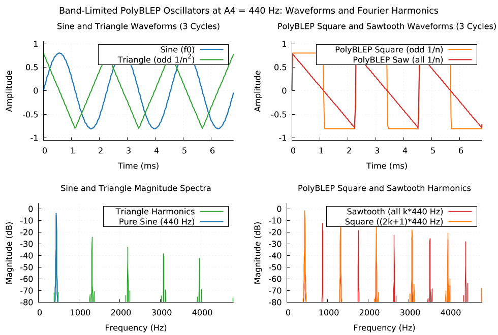 | 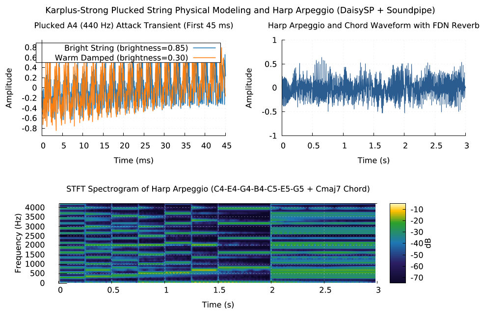 | 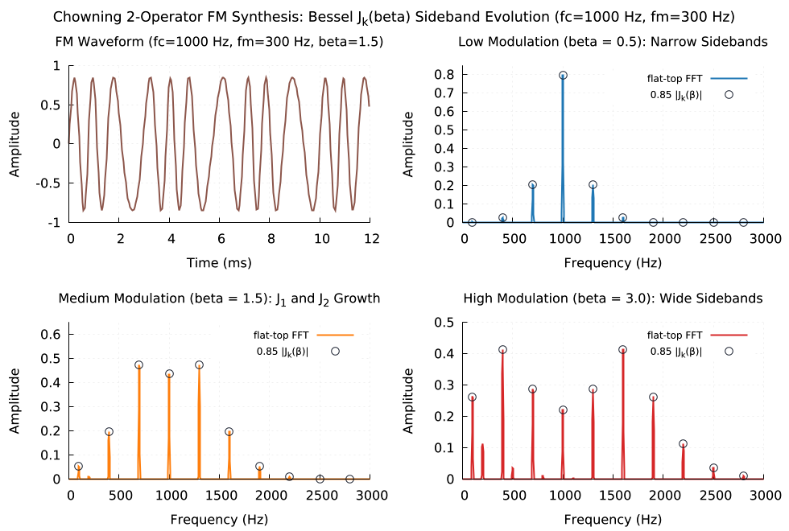 | 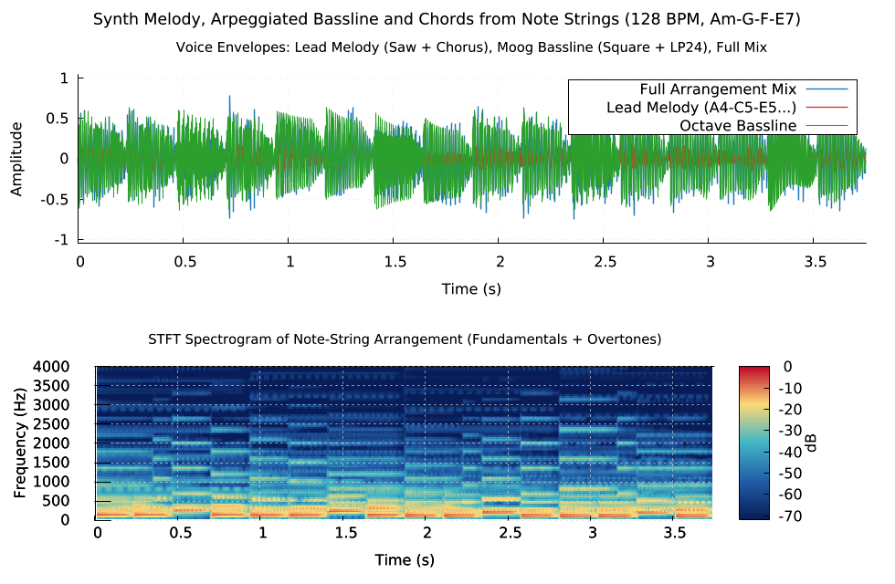 |
| **4-Band Parametric EQ** | **Studio FDN Reverb IR** | **YIN Pitch Tracking** | **Loudness & Resampling** |
| 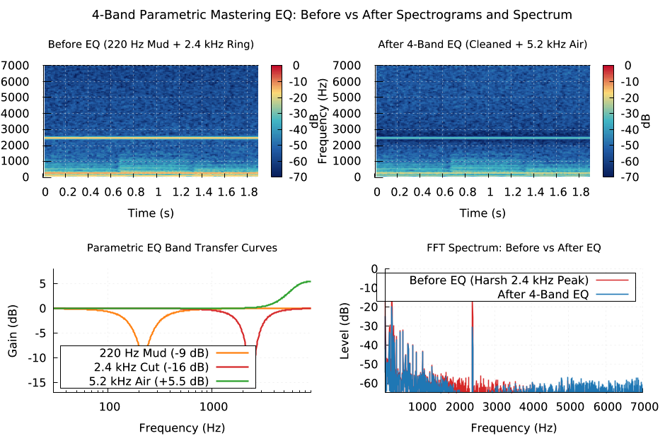 | 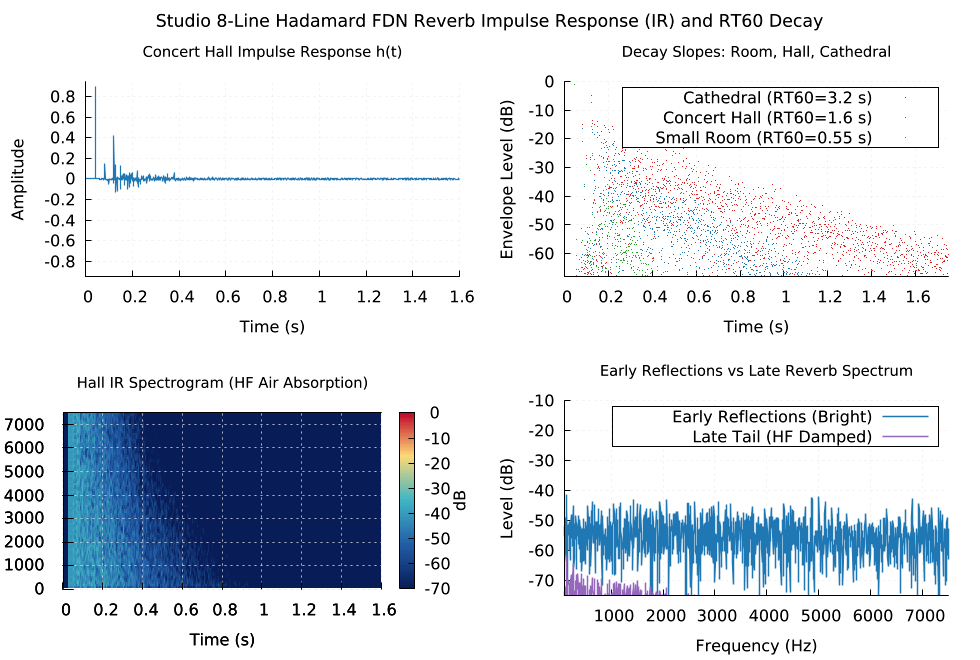 | 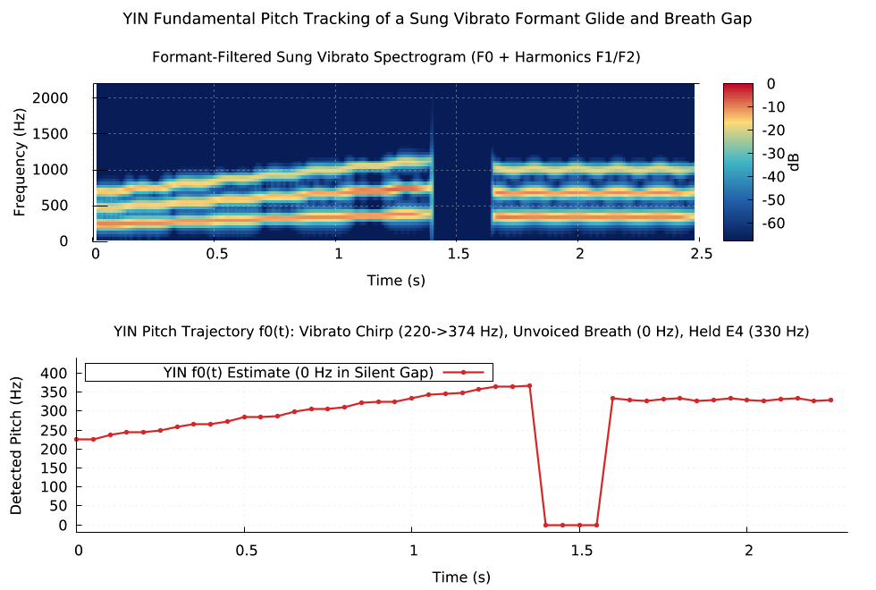 | 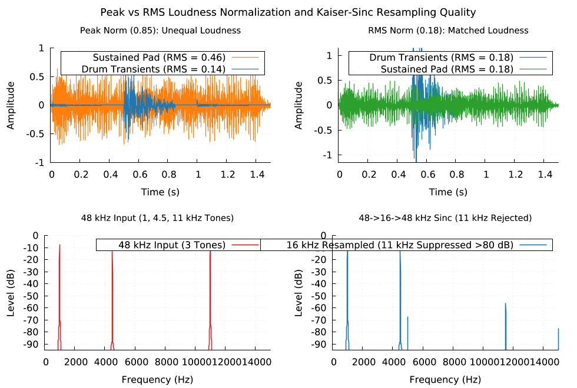 |

## Visual and Audio Gallery

Every image and `.wav` file below is generated deterministically by an `.lms` script in `examples/` (`lmaudio` synthesizes and analyzes the signal, exports `.wav` audio and `.csv` data, and `lmplot` renders the companion plots). Run any example directly from an empty directory with `lmctl autorun`:

### 1. Band-Limited PolyBLEP Oscillators and Fourier Harmonics


Audio: [`docs/audio/polyblep_harmonics.wav`](docs/audio/polyblep_harmonics.wav) (22.05 kHz, 16-bit mono, 113 KB)

```sh
lmctl autorun https://raw.githubusercontent.com/lmctl-ai/lmaudio/main/examples/polyblep_harmonics.lms
```

### 2. Karplus-Strong Plucked String Physical Modeling and Harp Arpeggio


Audio: [`docs/audio/karplus_strong_harp.wav`](docs/audio/karplus_strong_harp.wav) (22.05 kHz, 16-bit mono, 130 KB)

```sh
lmctl autorun https://raw.githubusercontent.com/lmctl-ai/lmaudio/main/examples/karplus_strong_harp.lms
```

### 3. Chowning 2-Operator FM Synthesis and Bessel Sideband Evolution


Audio: [`docs/audio/fm_bell_spectrum.wav`](docs/audio/fm_bell_spectrum.wav) (22.05 kHz, 16-bit mono, 117 KB)

```sh
lmctl autorun https://raw.githubusercontent.com/lmctl-ai/lmaudio/main/examples/fm_bell_spectrum.lms
```

### 4. Synthwave Melody, Arpeggiated Bassline, and Chords from Note Strings


Audio: [`docs/audio/synth_lead_melody.wav`](docs/audio/synth_lead_melody.wav) (22.05 kHz, 16-bit mono, 162 KB)

```sh
lmctl autorun https://raw.githubusercontent.com/lmctl-ai/lmaudio/main/examples/synth_lead_melody.lms
```

### 5. RBJ Audio-EQ-Cookbook Biquad Filter Bank (Analytical Bode Magnitude and Phase)

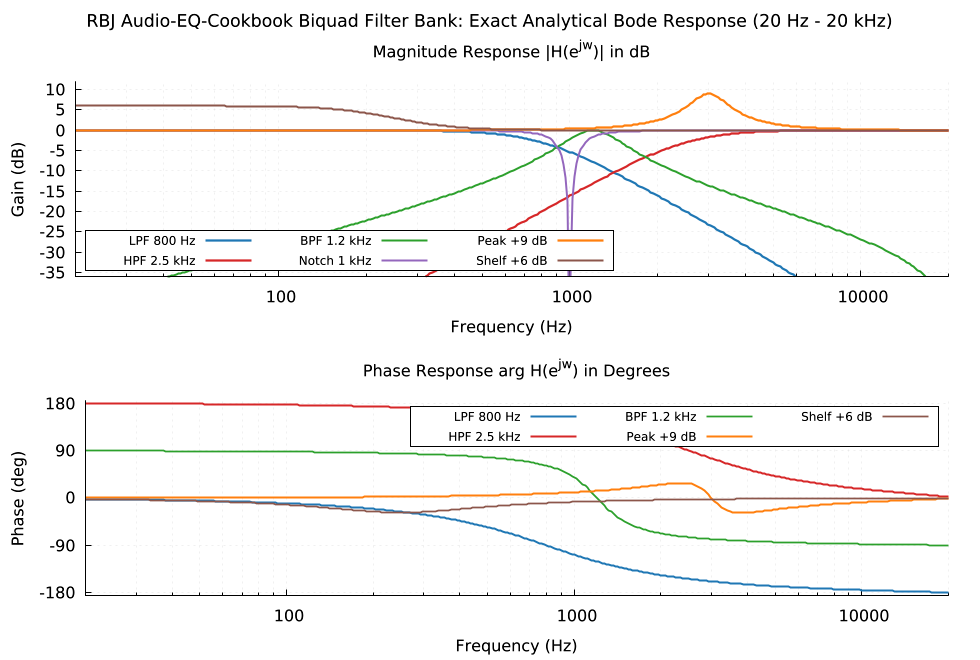

Audio: [`docs/audio/biquad_filter_bank.wav`](docs/audio/biquad_filter_bank.wav) (22.05 kHz, 16-bit mono, 121 KB)

```sh
lmctl autorun https://raw.githubusercontent.com/lmctl-ai/lmaudio/main/examples/biquad_filter_bank.lms
```

### 6. 4-Band Parametric Mastering EQ: Before vs After Spectrograms and Spectrum


Audio: [`docs/audio/eq_before_after.wav`](docs/audio/eq_before_after.wav) (22.05 kHz, 16-bit mono, 137 KB)

```sh
lmctl autorun https://raw.githubusercontent.com/lmctl-ai/lmaudio/main/examples/eq_before_after.lms
```

### 7. Huovilainen 24 dB/oct Moog Ladder Filter Resonance Sweep

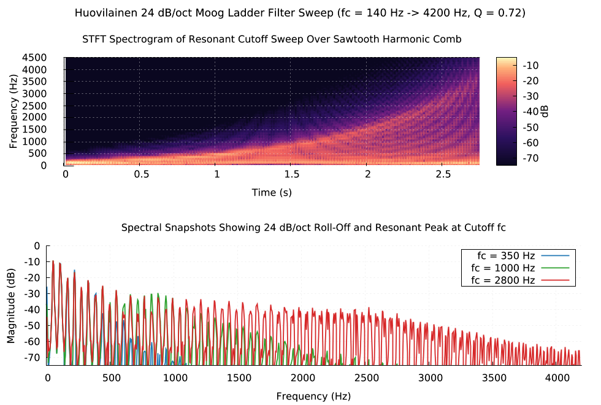

Audio: [`docs/audio/moog_ladder_sweep.wav`](docs/audio/moog_ladder_sweep.wav) (22.05 kHz, 16-bit mono, 121 KB)

```sh
lmctl autorun https://raw.githubusercontent.com/lmctl-ai/lmaudio/main/examples/moog_ladder_sweep.lms
```

### 8. Linear vs Exponential Swept-Sine Chirp STFT Spectrograms

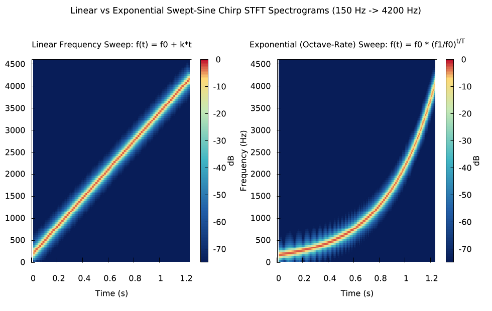

Audio: [`docs/audio/chirp_spectrogram.wav`](docs/audio/chirp_spectrogram.wav) (22.05 kHz, 16-bit mono, 113 KB)

```sh
lmctl autorun https://raw.githubusercontent.com/lmctl-ai/lmaudio/main/examples/chirp_spectrogram.lms
```

### 9. 808 Analog and Synthetic Drum Synthesis and Breakbeat Groove

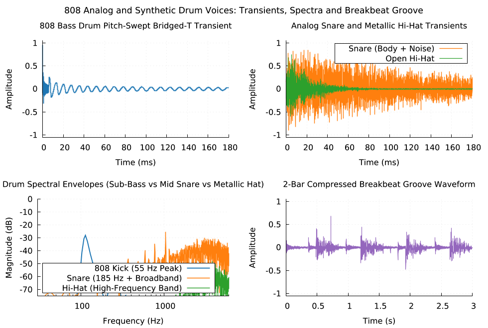

Audio: [`docs/audio/analog_drum_kit.wav`](docs/audio/analog_drum_kit.wav) (22.05 kHz, 16-bit mono, 134 KB)

```sh
lmctl autorun https://raw.githubusercontent.com/lmctl-ai/lmaudio/main/examples/analog_drum_kit.lms
```

### 10. Studio 8-Line Hadamard FDN Reverb Impulse Response and RT60 Decay


Audio: [`docs/audio/reverb_impulse_response.wav`](docs/audio/reverb_impulse_response.wav) (22.05 kHz, 16-bit mono, 143 KB)

```sh
lmctl autorun https://raw.githubusercontent.com/lmctl-ai/lmaudio/main/examples/reverb_impulse_response.lms
```

### 11. YIN Fundamental Pitch Tracking of a Sung Vibrato Formant Chirp


Audio: [`docs/audio/vocal_pitch_tracking.wav`](docs/audio/vocal_pitch_tracking.wav) (22.05 kHz, 16-bit mono, 108 KB)

```sh
lmctl autorun https://raw.githubusercontent.com/lmctl-ai/lmaudio/main/examples/vocal_pitch_tracking.lms
```

### 12. Peak vs RMS Loudness Normalization and Kaiser-Sinc Sample-Rate Conversion Quality


Audio: [`docs/audio/loudness_and_resampling.wav`](docs/audio/loudness_and_resampling.wav) (22.05 kHz, 16-bit mono, 130 KB)

```sh
lmctl autorun https://raw.githubusercontent.com/lmctl-ai/lmaudio/main/examples/loudness_and_resampling.lms
```

### 13. West-Coast Buchla Wavefolding and Studio FDN Reverb

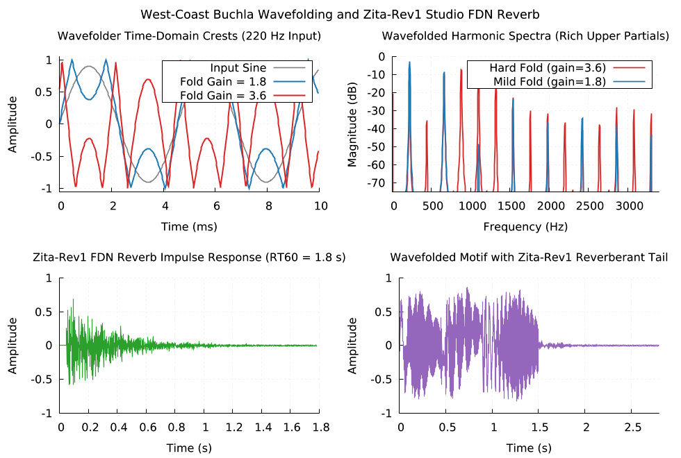

Audio: [`docs/audio/reverb_and_wavefolder.wav`](docs/audio/reverb_and_wavefolder.wav) (22.05 kHz, 16-bit mono, 121 KB)

```sh
lmctl autorun https://raw.githubusercontent.com/lmctl-ai/lmaudio/main/examples/reverb_and_wavefolder.lms
```

### 14. Animated Wavefolding and Resonant Ladder Filter Morphing

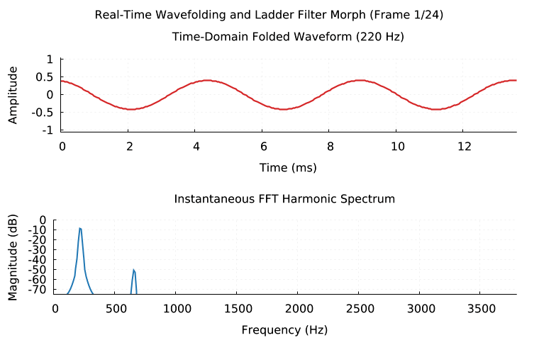

Audio: [`docs/audio/harmonic_morph_anim.wav`](docs/audio/harmonic_morph_anim.wav) (22.05 kHz, 16-bit mono, 125 KB)

```sh
lmctl autorun https://raw.githubusercontent.com/lmctl-ai/lmaudio/main/examples/harmonic_morph_anim.lms
```

---

## Quick Start

```js
mkdir("audio");
a = _dsl_ cli="lmaudio" install="github:lmctl-ai/lmaudio@latest";
let arp = audio.sequence("C4:0.5 E4:0.5 G4:0.5 C5:1.5", 120.0, "pluck", 22050);
let out = arp.reverb(0.82, 6500.0, 0.28).normalize(0.92);
audio.assert_close(out.peak(), 0.92, 0.001);
out.save_wav("audio/quickstart.wav", 16);
end _dsl_
savedsl(a, "build/quickstart.dslb");
r = system ${dsl_cli(a)} --dsl build/quickstart.dslb;
assert(r.code == 0);
```

## Embedded Libraries and License Compliance

`lmaudio` compiles into a single self-contained executable with zero runtime shared-library dependencies:

| Component | Upstream / Origin | License | Role in `lmaudio` |
|---|---|---|---|
| **DaisySP** | `electro-smith/DaisySP` (`2c72eaf`) | MIT | Band-limited PolyBLEP oscillators, 2-op FM (`Fm2`), Karplus-Strong `StringVoice`, `ModalVoice`, Huovilainen 24 dB/oct `LadderFilter`, `Svf`, `Adsr`, 808/synth drums (`AnalogBassDrum`, `SyntheticBassDrum`, `AnalogSnareDrum`, `SyntheticSnareDrum`, `HiHat`), `Chorus`, `Flanger`, `Phaser`, `Overdrive`, `Wavefolder` |
| **Soundpipe (clean subset)** | `PaulBatchelor/Soundpipe` (`3efb43b`) | MIT / BSD-3 | Core runtime (`base`, `ftbl`, `tevent`, `randmt`), dynamic range `compressor`, spectral `paulstretch`, and bundled `KissFFT` (`kiss_fft`, `kiss_fftr`). All Csound-extracted opcodes and `zitarev.c` are excluded from the build. |
| **DSP / FFT / STFT / Reverb / WAV Engine** | `cpp/audio.{hpp,cpp}` | MIT | Cooley-Tukey radix-2 + Bluestein chirp-z arbitrary-length FFT/IFFT, 2D STFT spectrogram, RBJ Audio-EQ-Cookbook biquads with exact analytical transfer function evaluation, 8-line Hadamard FDN reverbs (`reverb`, `zitarev`), 4-mode Euler-Bernoulli struck bar (`bar`), mid-tread `bitcrush`, YIN fundamental pitch estimator, Kaiser-windowed sinc resampling, scientific-pitch sequence/chord renderer, and PCM16/PCM24/FLOAT32 RIFF WAVE I/O (including `WAVE_FORMAT_EXTENSIBLE`) |

> **Why KFR, FFTW, libsndfile, and Csound/GPL Soundpipe modules were replaced:** `info.txt` listed `kfr` (dual GPL-2.0+ / commercial), `fftw` (GPL-2.0+), and `libsndfile` (LGPL-2.1+), while `third_party/soundpipe/modules/` contains Csound-extracted opcodes and `zitarev.c` (derived from `zita-rev1`). To keep `lmaudio` 100% permissive (MIT / BSD-3) in a single statically linked binary, `CMakeLists.txt` compiles only the 6 clean non-Csound, non-GPL Soundpipe modules (`base.c`, `ftbl.c`, `tevent.c`, `randmt.c`, `compressor.c`, `paulstretch.c`) plus `KissFFT`, and implements FFT/IFFT/STFT, RBJ biquads, 8-line Hadamard FDN reverbs (`reverb`, `zitarev`), modal bar (`bar`), `bitcrush`, windowed-sinc resampling, and WAV I/O directly in `cpp/audio.cpp` under the MIT license.

---

## DSL Reference (`context audio: Audio`)

### `Audio` Synthesis, Design, and I/O

- `audio.silence(sr: int, duration: float) -> Buffer` / `audio.silence(duration: float, sr: int) -> Buffer` / `audio.silence(duration: float) -> Buffer`
- `audio.sine(freq: float, duration: float, amp: float, sr: int) -> Buffer` (also 2- and 3-arg overloads at `sr = 44100`)
- `audio.cosine(freq: float, duration: float, amp: float, sr: int) -> Buffer`
- `audio.saw(freq: float, duration: float, amp: float, sr: int) -> Buffer` — PolyBLEP band-limited sawtooth
- `audio.square(freq: float, duration: float, amp: float, duty: float, sr: int) -> Buffer` — PolyBLEP band-limited pulse/square
- `audio.triangle(freq: float, duration: float, amp: float, sr: int) -> Buffer` — triangle oscillator
- `audio.chirp(f0: float, f1: float, duration: float, amp: float, mode: string, sr: int) -> Buffer` — `"linear"` or `"log"` swept sine
- `audio.impulse(duration: float, offset_sec: float, amp: float, sr: int) -> Buffer` — unit impulse at `offset_sec`
- `audio.noise(kind: string, duration: float, amp: float, seed: int, sr: int) -> Buffer` — deterministic `"white"`, `"pink"`, or `"brown"` noise
- `audio.expr(formula: string, duration: float, sr: int) -> Buffer` — sample-by-sample math expression in `t`, `n`, `sr`, `dur`
- `audio.fm(carrier: float, ratio: float, index: float, duration: float, amp: float, sr: int) -> Buffer` — Chowning 2-operator FM with modulation index $\beta$ in radians
- `audio.pluck(freq: float, duration: float, amp: float, brightness: float, damping: float, sr: int) -> Buffer` — Karplus-Strong plucked string
- `audio.modal(freq: float, duration: float, amp: float, structure: float, brightness: float, damping: float, sr: int) -> Buffer` — struck modal resonator
- `audio.bar(bc_left: int, bc_right: int, stiffness: float, decay: float, duration: float, amp: float, sr: int) -> Buffer` — 4-mode Euler-Bernoulli struck physical bar
- `audio.drum(kind: string, freq: float, duration: float, decay: float, tone: float, accent: float, sr: int) -> Buffer` — `"kick"`, `"synth_kick"`, `"snare"`, `"synth_snare"`, or `"hihat"`
- `audio.sequence(notes: string, bpm: float, instrument: string, sr: int) -> Buffer` — renders space-separated tokens `"C4:1 E4:0.5 R:0.5 C4+E4+G4:2"` with instrument `"sine"`, `"saw"`, `"square"`, `"triangle"`, `"fm"`, `"pluck"`, `"modal"`, or `"pad"`
- `audio.note_freq(note: string) -> float` / `audio.midi_freq(midi: float) -> float`
- `audio.load_wav(path: string) -> Buffer` / `audio.stereo(left: Buffer, right: Buffer) -> Buffer`
- `audio.biquad_design(kind: string, freq: float, q: float, db_gain: float, sr: int) -> Biquad` — `"lowpass"`, `"highpass"`, `"bandpass"`, `"notch"`, `"peak"`, `"lowshelf"`, `"highshelf"`, `"allpass"`
- `audio.assert_close(actual: float, expected: float, tol: float) -> void`

### `Buffer` Processing, Effects, Analysis, and Export

- **Inspection**: `.sr()`, `.channels()`, `.frames()`, `.duration()`, `.get(frame[, channel])`, `.channel(ch)`, `.to_mono()`
- **Gain & Envelopes**: `.gain(factor)`, `.gain_db(db)`, `.normalize([target_peak])`, `.normalize_rms(target_rms)`, `.fade(in_sec, out_sec[, shape])`, `.adsr(attack, decay, sustain, release[, gate_sec])`, `.pan(pos)`
- **Editing**: `.slice(start_sec, end_sec)`, `.pad(before_sec, after_sec)`, `.concat(other)`, `.mix(other[, gain[, offset_sec]])`, `.reverse()`, `.resample(new_sr)`
- **Filters & Effects**: `.biquad(kind, freq, q[, db_gain])`, `.svf(mode, cutoff, res[, drive])`, `.ladder(cutoff, res[, drive, mode])`, `.lpf_sweep(f0, f1, res)`, `.delay(delay_sec, feedback, wet)`, `.reverb(feedback, lpf_freq, wet)`, `.zitarev(rt60_low, rt60_mid, damping, wet)`, `.chorus(rate, depth, feedback, wet)`, `.flanger(rate, depth, feedback, wet)`, `.phaser(rate, depth, feedback, poles, wet)`, `.overdrive(drive, wet)`, `.wavefold(gain, offset)`, `.bitcrush(bitdepth, crush_sr)`, `.compress(ratio, thresh_db, attack, release, makeup_db)`, `.paulstretch(stretch, window_sec)`
- **Analysis**: `.rms([ch])`, `.peak([ch])`, `.dc_offset([ch])`, `.energy([ch])`, `.zcr([ch])`, `.pitch([fmin, fmax])`, `.peak_freq([window])`, `.centroid([window])`, `.thd([fundamental_hz, harmonics])`, `.snr_db(reference)`, `.spectrum([window[, nfft]])`, `.spectrogram(win_size, hop_size[, window, max_freq])`
- **Export**: `.save_wav(path[, bits])` (`bits = 16`, `24`, or `32`), `.save_csv(path[, max_points[, stride]])`

### `Spectrum`, `Spectrogram`, and `Biquad`

- **`Spectrum`**: `.bins()`, `.nfft()`, `.sr()`, `.freq_at(bin)`, `.mag_at(bin)`, `.db_at(bin)`, `.phase_at(bin)`, `.mag_at_freq(freq_hz)`, `.peak_bin()`, `.peak_freq()`, `.peak_mag()`, `.centroid()`, `.parseval_energy()`, `.ifft()`, `.save_csv(path[, max_freq])`
- **`Spectrogram`**: `.frames()`, `.bins()`, `.sr()`, `.time_at(frame)`, `.freq_at(bin)`, `.mag_at(frame, bin)`, `.db_at(frame, bin)`, `.ridge_freq(frame)`, `.save_csv(path[, floor_db])`
- **`Biquad`**: `.b0()`, `.b1()`, `.b2()`, `.a1()`, `.a2()`, `.gain_at(freq_hz)`, `.db_at(freq_hz)`, `.phase_deg_at(freq_hz)`, `.apply(buf)`, `.save_response_csv(path[, points, fmin, fmax])`

---

## Resource limits

- **Memory budget (`LMAUDIO_MAX_MEMORY_MB`)**: Total heap and native DSP memory is capped at `4096 MiB` by default and configurable via `LMAUDIO_MAX_MEMORY_MB` (must be a positive whole number in `1..1048576`). Both C++ allocations (`operator new`) and Soundpipe C allocations (`sp_data`, `sp_ftbl`, `sp_paulstretch`, `sp_compressor`) are charged against this budget. Exceeding the budget stops execution immediately with exit code `3`, a human-readable line on `stderr`, and a structured JSON error on `stdout`.
- **Sample rate and buffer bounds**: Sample rate `sr` must be in `[8000, 192000] Hz`, channel count in `[1, 8]`, single-call synthesis duration in `(0, 300] s`, and total buffer length in `[1, 200000000]` frames.
- **CLI usage**:
  ```
  usage: lmaudio --version | --notices | --dsl-schema [--json] | --dsl-signatures | [--dry-run] --dsl FILE [FILE ...]
  ```

## Building and Testing

```sh
scripts/sync-deps.sh
scripts/sync-sdk.sh --verify
./test.sh
```
